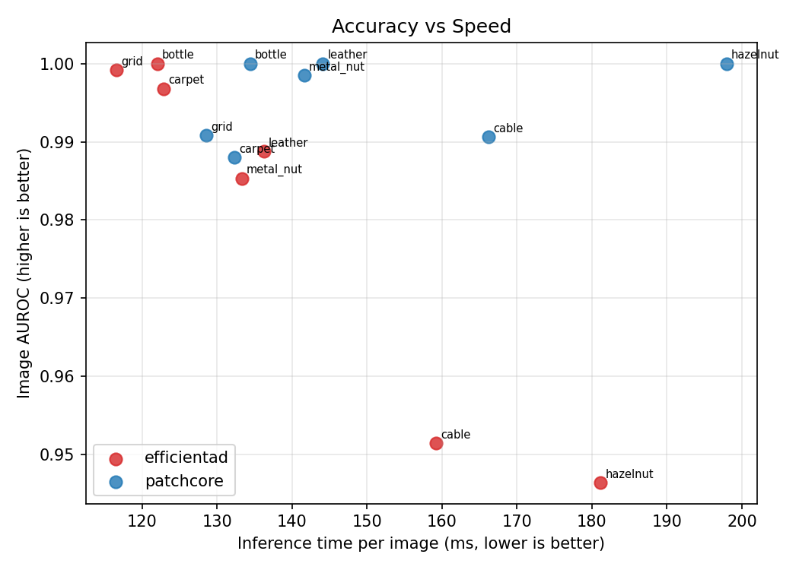
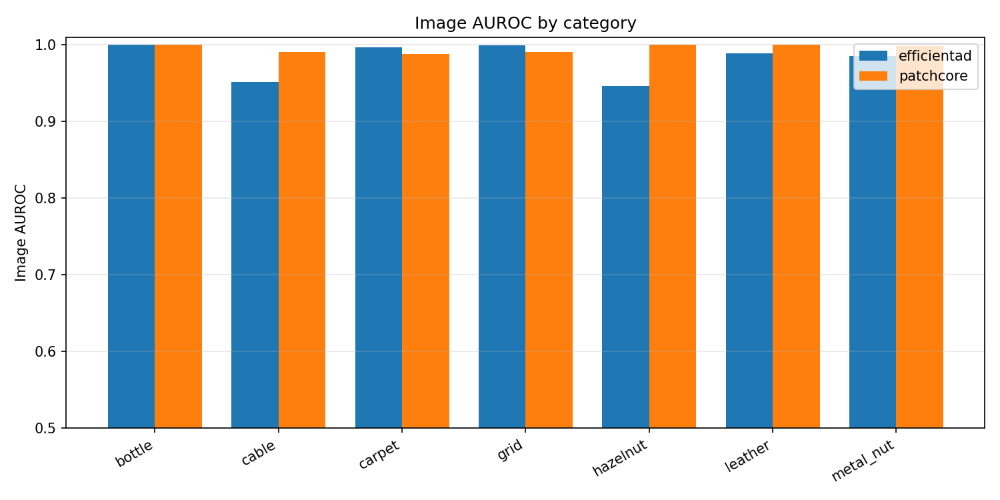
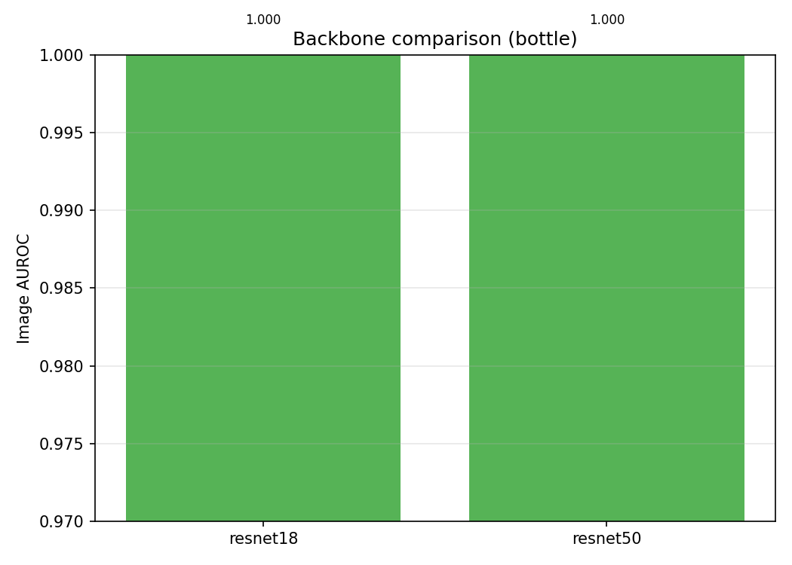
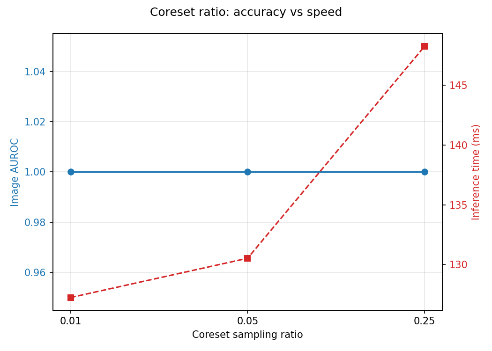
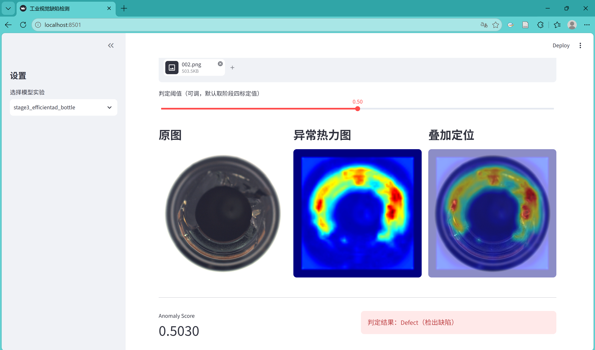
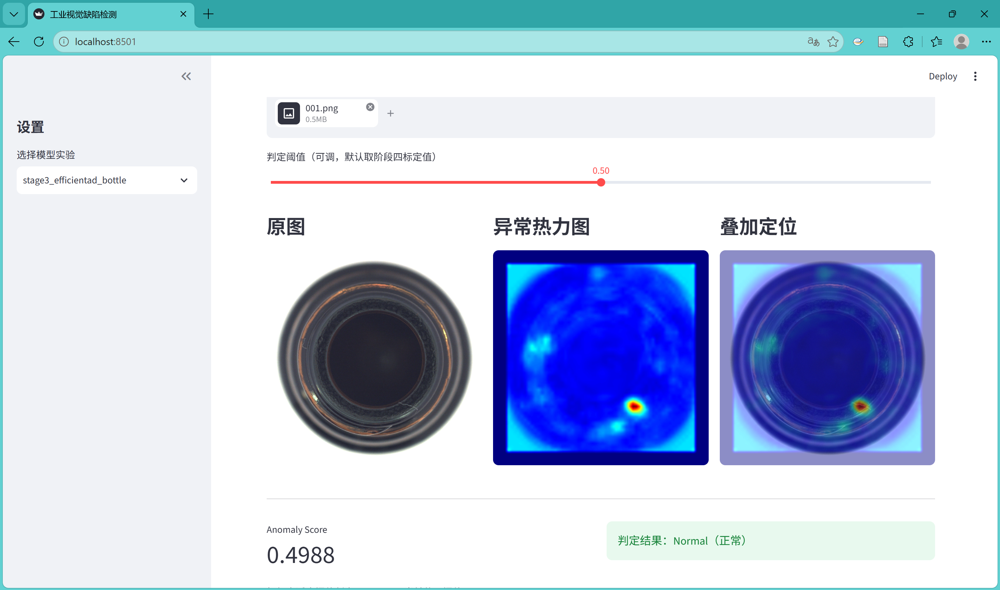

# Industrial Anomaly Detection — 工业视觉缺陷检测与异常定位系统

基于 **MVTec AD** 数据集，使用 **PatchCore** 与 **EfficientAD** 实现工业图像的无监督缺陷检测与像素级异常定位，覆盖「数据处理 → 模型训练/特征库构建 → 多类别实验 → 评估优化 → 阈值工程 → 异常热力图 → 推理脚本 → Streamlit Demo」的 AI 工程流程；并提供一份**不依赖 Anomalib 的简化 PatchCore**用于实现对照。

> 状态：已有 AutoDL RTX 3080 Ti 实验记录与权重，包含 7 类×2 模型对比及 bottle 消融。应用层支持本地 CPU、统一推理服务、Streamlit 批次检测和 FastAPI；不需要重新训练已有模型。历史阈值/指标采用测试集复用协议，独立校准与测试验证尚待补充，不能解释为产线泛化保证。最小 PatchCore 有源码与冒烟测试，正式 GPU 成绩未提供可核验记录。
> 框架：[Anomalib v2.6.2](https://github.com/open-edge-platform/anomalib)（PyTorch / Lightning）

## 应用工程与实现范围

模型主体采用 Anomalib 的 PatchCore/EfficientAD；本项目重点实现模型应用与实验管理：

- **统一推理服务**：CLI、Streamlit、FastAPI 共用图片校验、模型加载、阈值比较与结果结构；默认 CPU，每进程常驻一个模型，相同权重重复调用不重新初始化。
- **批次检测与复核**：页面支持最多 10 张同类图片、逐图定位、细粒度阈值调节；调整阈值复用已有预测，可下载 CSV、JSON 和定位 PNG。
- **可追溯输出**：记录检测 ID、时间、模型权重版本、图片 SHA256、实际阈值及来源；明确异常分数与缺陷概率的区别。
- **接口与输入处理**：提供 `/health`、`/models`、`/predict` 和交互接口文档；拒绝损坏/超限图片，返回明确错误；通过 CPU 合同测试检查并发加载、边界判定和页面复用。
- **配置化实验**：多模型多类别编排、参数对照、日志/指标/热力图汇总，保留 OOM 等失败记录；性能和阈值结论按实际证据限定范围。

使用步骤、设计取舍和 CPU 验收见 [应用说明](docs/application.md)。模型算法采用已有方法，工程实现与实验观察分别说明。

## 目录结构

```
industrial-anomaly-detection/
├── configs/        # YAML 配置（数据、模型、引擎、指标、批量矩阵、消融），不硬编码超参
├── data/           # MVTec AD 数据集与 imagenette（不入库）
├── src/
│   ├── data/       # 数据模块工厂（MVTecAD / Folder，含 Jupyter 残留自动清理）
│   ├── models/     # PatchCore / EfficientAD 模型工厂
│   ├── train/      # 训练 / 特征库构建统一入口
│   ├── evaluation/ # 指标（Image/Pixel AUROC、AUPRO、F1）与汇总
│   ├── inference/  # 批量/单图推理、anomaly score、三联热力图
│   └── experiments/# 阶段三矩阵对比、阶段四消融/阈值标定/报告生成
├── app/            # Streamlit 检测台 + FastAPI（共用 src/inference/service.py）
├── baselines/      # 简化 PatchCore 对照实现（timm + sklearn 等）
├── scripts/        # 服务器运行脚本（各阶段一键脚本、数据/imagenette 准备）
├── docs/           # 展示用分析产物：消融报告、experiments.csv、对比 tables/figures、Demo 截图
├── results/        # 实验指标、热力图、阈值、权重、日志（不入库）
├── tests/          # 快速测试 + CPU 端到端冒烟测试
├── 项目任务书.md    # 完整项目规划、参考实现、数据集下载直链与存储占用
├── requirements.txt
├── pyproject.toml  # ruff / pytest 配置
├── README.md
└── .gitignore
```

## 数据集

- **MVTec AD**：15 个类别（10 物体 + 5 纹理），5,354 张高分辨率图像（3,629 张训练正常图 + 1,725 张测试图），缺陷测试图带像素级 mask；
- **整包下载直链**（约 4.90 GiB / 5.26 GB，`mvtec_anomaly_detection.tar.xz`）：
  <https://www.mydrive.ch/shares/150996/b52ecdcbf521176e9db9c731f2304b27/download/420938113-1629960298/mvtec_anomaly_detection.tar.xz>
- 单类别下载直链与各类别存储占用见 `项目任务书.md` 附录 B；
- **EfficientAD** 训练还需 **imagenette**（ImageNet 子集，约 1.5 GB），用于惩罚学生网络在自然图像上的输出；
- 解压后目录结构：`data/mvtec_anomaly_detection/<category>/{train/good, test/<缺陷类型>, ground_truth/<缺陷类型>}`；
- 许可证 **CC BY-NC-SA 4.0**，仅限非商业学术用途；数据集、权重、完整实验产物均不提交 Git。

## 环境搭建

要求 **Python 3.10**（本地 Windows CPU 与远程 GPU 服务器保持一致）。

**本地（Windows，无 GPU，开发、CPU 推理展示与轻量测试）：**

```powershell
conda create -n iad-cpu python=3.10 -y
conda activate iad-cpu
pip install "anomalib[cpu]==2.6.2"
pip install -r requirements.txt
```

**GPU 服务器（AutoDL，RTX 3080 Ti / 3090 / 4090，CUDA 12.6 路线）：**

```bash
conda create -n iad python=3.10 -y
conda activate iad
pip install "anomalib[cu126]==2.6.2"   # 自动安装匹配的 torch 2.6+/torchvision
pip install -r requirements.txt
```

> 国内网络说明：预训练 backbone 权重从 HuggingFace 拉取。`src/__init__.py` 与 `scripts/*.sh`
> 已默认把 `HF_ENDPOINT` 指向 `https://hf-mirror.com`；AutoDL 上建议先执行
> `source /etc/network_turbo` 开启学术加速（EfficientAD 的 teacher 权重与 imagenette 均在境外）。
> Windows 用户目录若含非 ASCII 字符（如中文用户名），权重缓存与临时目录会自动重定向到项目内
> 纯英文路径，规避 anomalib 的路径校验问题。

## 使用方式（统一命令入口）

所有超参集中在 `configs/*.yaml`，三个基础入口均可通过 `--config` 切换实验：

```bash
# 1. 训练 / 构建特征库（PatchCore 只需 1 个 epoch；EfficientAD 约 100 epoch）
python -m src.train.train --config configs/patchcore_bottle.yaml

# 2. 评估：Image/Pixel AUROC、AUPRO、F1 + 测试集热力图 + scores.csv，
#    并把本次实验追加到 results/experiments.csv
python -m src.evaluation.evaluate --config configs/patchcore_bottle.yaml

# 3. 推理：整个测试集 / 单张图片 / 某个目录
python -m src.inference.predict --config configs/patchcore_bottle.yaml --input test
python -m src.inference.predict --config configs/patchcore_bottle.yaml \
    --input data/mvtec_anomaly_detection/bottle/test/broken_large/000.png
```

### 批量实验（阶段三 / 四 / 五 / 六）

```bash
# 准备 imagenette（EfficientAD 依赖，只需一次）
bash scripts/setup_imagenette.sh

# 阶段三：7 类别（bottle/cable/metal_nut/hazelnut/grid/leather/carpet）× 2 模型批量对比
#   自动展开配置、串行 train+evaluate，支持断点续跑（读 experiments.csv 跳过已完成）
bash scripts/run_stage3.sh

# 阶段四：bottle 上的工程消融 + 阈值标定 + 报告
#   消融维度：backbone / feature layers / coreset ratio / num_neighbors（控制变量、去重、断点续跑）
#   阈值：扫阈值画 PR 曲线，选最优 F1，并给召回≥0.99 / 精度≥0.95 约束下的工作点
bash scripts/run_stage4.sh
# 报告：精度-速度散点、类别柱状图、coreset/backbone 趋势图、透视表
python -m src.experiments.report

# 本地应用：批次检测、阈值复核与结果导出（默认 CPU）
python -m streamlit run app/streamlit_app.py --server.address 127.0.0.1
# API（另一个终端）；文档 http://127.0.0.1:8000/docs
python -m uvicorn app.api:app --host 127.0.0.1 --port 8000 --log-config configs/logging.yaml

# 简化 PatchCore 对照（timm 取 layer2/3 特征 → greedy coreset → 1-NN → 上采样）
python baselines/minimal_patchcore.py --layout mvtec \
    --root data/mvtec_anomaly_detection/bottle --out results/minimal_bottle
```

## 实验结果速览

已有 **24 条成功实验记录**，见 [`docs/experiments.csv`](docs/experiments.csv)：1 条初始 baseline、14 条多类别对比、9 条成功消融配置（含消融 baseline，部分 baseline 配置重复）。另有 1 个三层特征配置因 OOM 失败，未计入成功记录。对比表见 [`docs/tables/`](docs/tables/)，历史消融说明见 [`docs/消融实验说明报告.md`](docs/消融实验说明报告.md)，其“省显存提速”等结论需结合下述测量边界阅读。

**评估边界：**当前数据模块沿用 Anomalib 2.6.2 的 `SAME_AS_TEST` 验证设置，后处理标定和测试数据有重用；额外阈值扫描也在测试集上完成。以下是该协议下的实验观察，F1/最优阈值不能当作独立测试成绩。应用改造没有重新训练模型或增加精度实验。

**阶段三（7 类 × PatchCore / EfficientAD）关键对比（metal_nut 为例）：**

| 模型 | Image AUROC | Pixel AUROC | AUPRO | Image F1 | Pixel F1 | 批量流程均摊耗时 |
|---|---|---|---|---|---|---|
| PatchCore (WR50) | 0.9985 | 0.9871 | 0.9423 | 0.9891 | 0.8416 | 141.6 ms |
| EfficientAD (s) | 0.9853 | 0.9748 | 0.9127 | 0.9674 | 0.8087 | 133.3 ms |

计时包含 Engine.predict 内的权重恢复、数据准备/加载和预测，评估 batch size 为 32；不是常驻模型 batch=1 的稳态延迟，FPS 也不能作为部署吞吐保证。未记录 GPU 峰值显存。以下历史图表按该口径展示：



各类别 Image AUROC 对比：



**阶段四消融（bottle，PatchCore）核心结论：**
- 本次 bottle 单种子对照中，WR50 的像素定位指标高于 resnet50/resnet18；尚未验证跨类别结论。
- 仅 layer2 的 AUPRO 为 0.9632，高于 layer2+layer3 的 0.9452；三层配置在当时输入尺寸、batch 和实现下于 12GB 卡 OOM。
- coreset 从 0.1 降至 0.01，Pixel AUROC 0.985663→0.985211，AUPRO 0.945246→0.941845；小幅定位精度损失下减少记忆库条目。完整 checkpoint 约 220.61→107.75 MiB，不能等同为整体显存降低 90%。
- 近邻数 1/3/9 的汇总指标相同，但逐样本分数不同；该参数主要作用于图像评分重加权，不能据像素指标相同认定检索机制完全不敏感。

backbone 与 coreset 趋势：

 

## Streamlit Demo

当前页面支持批次上传、模型选择、原图/热力图/定位、异常数量与 CSV/JSON/PNG 导出。阈值默认沿用 checkpoint，人工调整仅更新 `score > threshold` 判定，不重复模型计算；不自动加载历史测试集 best F1 阈值。分数不是概率，单图热力图颜色表示相对强度。以下为历史单图版本截图：

| 缺陷样本（score 0.503 → Defect） | 正常样本（score 0.499 → Normal） |
|---|---|
|  |  |

本地运行（Windows CPU，推荐 EfficientAD，PatchCore CPU 推理较慢）：

```powershell
python -m streamlit run app/streamlit_app.py --server.address 127.0.0.1
```

## 测试与静态检查（本地 CPU）

```powershell
# 快速测试（目录结构、配置、工厂、矩阵、消融、阈值、报告）
python -m pytest tests/ -v -m "not slow"
# 含端到端冒烟（合成数据跑通 train→evaluate→推理，首次会下载 backbone 权重）
python -m pytest tests/ -v
# 静态检查
python -m ruff check .
```

## 路线图

- [x] 阶段一：bottle 单类别 PatchCore Baseline（指标 + 热力图 + 日志 + CPU 冒烟）
- [x] 阶段二：统一入口与配置化封装（train/evaluate/predict + configs）
- [x] 阶段三：多类别 × PatchCore/EfficientAD 批量对比（7 类×2 模型，精度 / 速度 / FPS）
- [x] 工程消融 + 探索性阈值扫描 + 报告图表（同集扫描，不作为独立校准成果）
- [x] 阶段五：Streamlit Demo（上传图 → 原图/热力图/score/Normal·Defect，阈值可调）
- [x] 简化 PatchCore 对照实现与 CPU 冒烟测试入口（正式 GPU 结果未附）
- [x] AutoDL GPU 正式实验（阶段一 / 三 / 四）
- [x] README 结果回填与 GitHub 整理
- [x] 本地 CPU 统一推理服务、模型复用与一致业务判定
- [x] Streamlit 批次检测、结果导出与模型/图片追溯字段
- [x] FastAPI 健康检查、模型列表、图片推理与接口合同测试
- [ ] 独立 calibration/test 协议、冻结阈值后的最终评价
- [ ] 常驻模型 warmup、多次重复的延迟/吞吐与 GPU 峰值显存测量

## 参考实现

- [open-edge-platform/anomalib](https://github.com/open-edge-platform/anomalib)：主力框架（Apache-2.0）
- [amazon-science/patchcore-inspection](https://github.com/amazon-science/patchcore-inspection)：PatchCore 官方实现，Roth et al., CVPR 2022（arXiv:2106.08265）
- [nelson1425/EfficientAD](https://github.com/nelson1425/EfficientAD)：EfficientAD 复现，Batzner et al., WACV 2024（arXiv:2303.14535）
- [MVTec AD Dataset](https://www.mvtec.com/research-teaching/datasets/mvtec-ad)
